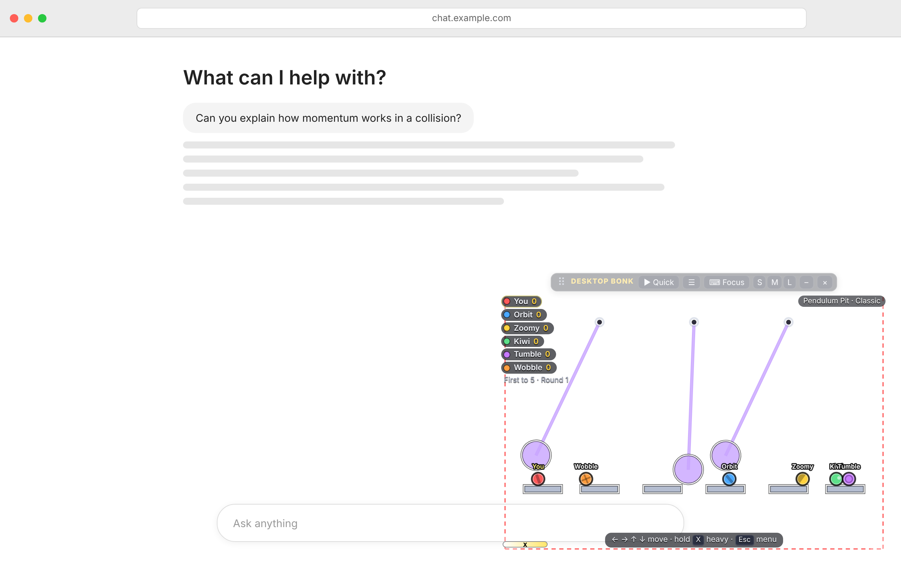

# Desktop Bonk

A small, offline Bonk.io-style physics brawler for macOS. Its arena floats over your desktop in a transparent, always-on-top window, and every opponent is a bot.

Circular players, force-based arrow-key movement, a heavy mode on **X**, Box2D rigid-body physics (via [planck.js](https://github.com/piqnt/planck.js)), 30 original maps, bots with six difficulty levels and six personalities, Classic, Teams, Arrows, Grapple and Football modes, and a map editor.



> Original game, original assets. It does not connect to, imitate or depend on Bonk.io's servers or accounts, and it copies no Bonk.io maps or art.

---

## Build and run

You need macOS 12 or later and Xcode (or just the command-line tools: `xcode-select --install`).

### Option A: build a real `.app` (recommended)

```bash
./build_app.sh
open build/DesktopBonk.app
```

The script compiles a universal binary with `swiftc` (it falls back to your Mac's own architecture if one slice fails), bundles the game files, makes the icon and ad-hoc signs the app. Drag `build/DesktopBonk.app` into `/Applications` if you want to keep it.

### Option B: Xcode

Open `Package.swift` in Xcode (**File ▸ Open…**), choose the *DesktopBonk* scheme and *My Mac*, then press **Run**.

### Option C: play the game in a browser (no build)

Open `Sources/DesktopBonk/Web/index.html` in Safari or Chrome. Everything except the native overlay features (transparent floating window, click-through, launcher, global shortcuts) works in the browser.

---

## Controls

| Key | Action |
|---|---|
| ← → | push left / right (forces, not walking) |
| ↑ | upward thrust (weaker than gravity: it softens falls and boosts bounces) |
| ↓ | slam downward |
| **X** (hold) | **heavy**: about 3.2× mass, hard to push and hits much harder, but slow to accelerate. Holding it drains its strength (meter at the bottom left), and releasing it recharges. |
| **Z** | special key: Arrows (hold to charge, ←/→ aim, release to fire), Grapple (hold plus a direction to fire a rope, ↑/↓ reel), Football (kick) |
| Esc | pause / menu |
| Enter | Quick Match (from the main menu) / rematch |
| Space (hold) | fast-forward while spectating |
| WASD | optional alternative to the arrows (Settings ▸ Controls) |

Global shortcuts work from any app and need no Accessibility permission:

* **⌃⌥B**: show or hide the arena
* **⌃⌥G**: give the game keyboard focus

You can change both under Settings ▸ Controls.

---

## The desktop overlay

* The window is borderless and fully transparent. Only the platforms, balls and small UI pieces are drawn, so Safari (or whatever is behind it) stays visible.
* The window floats above normal windows. To turn that off, use Settings ▸ Desktop ▸ Always on top, or the menu-bar item.
* **Click-through:** clicks on the transparent parts of the arena pass to the app underneath. Only the toolbar, menus and buttons catch the mouse. You can turn this off.
* **Keyboard:** while the arena is focused, it receives your keys. Click Safari and typing goes back to Safari. To return to the game, press **⌨ Focus** on the arena's toolbar, click the yellow "click here to play" hint, or use ⌃⌥G. If *Pause when unfocused* is on, the match pauses while you're away.
* **Moving and sizing:** drag **⠿** to move the arena, drag the bottom-right corner grip to resize it, or use the **S/M/L** buttons (480×360 / 720×520 / 960×680). Settings ▸ Desktop also has exact width and height, position presets, background (transparent / translucent / solid), filled or outline-only platforms, outline colour, whether the arena stays visible while another app is focused, and a frame-rate limit.
* **–** minimizes the arena to a small floating ball (the launcher), which you can drag anywhere and click to resume. **×** (or ⌃⌥B) hides the arena instantly.
* A menu-bar item (●) has Show/Hide, Focus, Quick Match, Settings, Editor, sizes, Always on Top and Quit. The app has no Dock icon.
* No Screen Recording permission is used or needed. The app runs entirely offline.

Settings, custom maps and window placement are saved to `~/Library/Application Support/DesktopBonk/store.json` and the app's user defaults.

---

## Playing

**Quick Match** is one human and 5 bots on Normal difficulty, Classic mode, random map rotation, first to 5. The arena appears, there's a short countdown, and you're playing. Between rounds the winner, the scores and the next countdown are shown; the game never drops back to the menu. At the end you get **Rematch / New map / Menu / Minimize**. You can save your own Quick Match defaults from Custom Match.

Rules (Classic): there is no health, there are no weapons, and you can't punch. You are eliminated when your ball leaves the map boundary in *any* direction (red dashed lines show where boundaries are near) or touches a red striped hazard. The last ball left wins the round. **Overtime:** after 35 s the side boundaries close in (shaded red), so every round ends.

**Modes**

* **Classic**: every ball for itself.
* **Teams**: red vs blue; the last team with a survivor wins.
* **Arrows**: arrows are physical projectiles with momentum. Charging takes time and firing pushes you back (recoil).
* **Grapple**: a real rope constraint (Box2D rope joint) to solid geometry, held for up to 3.2 s. Swing, reel in, recover.
* **Football**: two teams, a physics ball, two goals. Z kicks; the first team to the target number of goals wins.

---

## The 30 maps

| # | Map | What makes it different |
|---|---|---|
| 1 | Flatline | long platform, two raised blocks hanging near the edges |
| 2 | Twin Islands | two islands and a pushable raft on a sliding (prismatic) joint |
| 3 | The Valley | two ramps form a V; launch rivals up and off the ends |
| 4 | Four Corners | four islands linked by thin sloped bridges |
| 5 | Narrow Escape | thin beam with small gaps and launch ramps |
| 6 | The Bowl | smooth curved bowl (chain-shape surface) |
| 7 | Spinning Plank | motor-driven beam rotating round a hub |
| 8 | Double Spinner | two beams counter-rotating, with a safety ledge |
| 9 | Moving Bridges | three bridges on timed paths; the gaps open and close |
| 10 | The Elevator | three levels of ledges and vertical lifts |
| 11 | Seesaw Showdown | three free seesaws on pivots; mass tips them |
| 12 | Gearbox | three spinning discs with blocks bolted on, each at its own speed |
| 13 | Pinball | bumpers that kick, elastic walls, a centre drain |
| 14 | The Crusher | two giant walls slide in and out |
| 15 | Pendulum Pit | heavy dynamic pendulums (energy-maintained) over narrow platforms |
| 16 | Springboard | platforms on spring + slider joints; go heavy to load them |
| 17 | Breakaway | a weld-jointed bridge that breaks from force and fatigue |
| 18 | Piston Panic | side and floor pistons on timed fire patterns |
| 19 | Gravity Chamber | gravity rotates every 9 s, with a visible warning arrow; lethal pillar |
| 20 | The Maze | tunnels, blocks, ramps and open shafts |
| 21 | Tiny Ledges | many tiny platforms |
| 22 | Vertical Shaft | tall shaft, staggered ledges, two rotating barriers, lethal floor |
| 23 | The Ring | inside a ring with openings low on both sides and at the top |
| 24 | Triangles | wedges, ramps and a swinging triangle |
| 25 | Ice Slide | frictionless ramps; momentum lasts forever |
| 26 | Floating Chaos | free-floating dynamic objects drifting around a small core |
| 27 | Split Arena | two chambers and a motorised drawbridge on a timed schedule |
| 28 | The Funnel | huge slopes into a tiny pad guarded by a spinning cross |
| 29 | Clockwork | gears, rotating arms and a sliding bar, all on a fixed beat |
| 30 | Ultimate Bonk | rotating beam, springs, sliding platforms, slopes, breakable floor |

There are also two football pitches. Every map is plain data (`Sources/DesktopBonk/Web/js/maps.js`) fed through one builder (`world.js`). Map previews are drawn from the real geometry.

---

## Bots

Bots press the same virtual keys you do, and the simulation applies identical forces to every ball. Difficulty never changes mass, force, speed or collision strength.

Every few frames a bot:

1. perceives opponents (low levels add noise and react late) and probes the map with raycasts: ground under it, distance to the nearest edges, walls that protect, moving or rotating supports;
2. rolls out short-horizon physics predictions for each of the 9 directional inputs (plus "back off, then charge" plans). Each prediction includes moving-surface velocity, bounces, other balls as moving bodies with momentum exchange, and a second recovery phase ("can I still save myself?");
3. scores each outcome for survival, support, edge distance, rotating or tilting supports (for example, the far end of a spinning plank is dangerous), incoming threats, and attack value (impact strength × how much it shoves the target toward *its* nearest edge, plus whether that impact should push it off);
4. runs a behavioural layer on top (approach → back off → charge → recoil, or wait in the middle) and a separate heavy controller that times **X** for impacts. Skilled bots also use heavy to pump springs, tip seesaws and brace near edges.

Bots attack each other as well as you, and pick targets by distance and how exposed they are.

| Level | Reaction | Look-ahead | Notes |
|---|---|---|---|
| 1 Beginner | ~330 ms | 0.8 s | noisy perception, frequent mistakes, mashes heavy randomly |
| 2 Casual | ~220 ms | 1.1 s | basic movement, sometimes times heavy |
| 3 Normal | ~130 ms | 1.5 s | avoids obvious hazards, reads moving surfaces |
| 4 Skilled | ~80 ms | 1.8 s | knows rotating supports, calculates kills, uses heavy deliberately |
| 5 Expert | ~50 ms | 2.1 s | precise prediction and heavy timing |
| 6 Insane | ~33 ms | 2.4 s | near-perfect perception, longest prediction |

Personalities (Aggressive, Defensive, Opportunistic, Risk-taker, Patient, Balanced) change the weighting of aggression, edge caution, threat avoidance and approach. You set them separately from difficulty.

---

## Map editor

**Main menu ▸ Map editor.** Tools: rectangles, circles, polygons (concave shapes are auto-split into convex pieces), spawn points (up to 8), pivots (revolute joints, with optional motors, limits and break force), springs (slider + spring joint), moving paths (kinematic, ping-pong or loop, with speed and wait), and kill boundaries. For any platform you can set friction, bounciness, density, colour, hazard (lethal), decor (non-colliding), bumper strength, spin, and static, kinematic or dynamic type. Undo, duplicate and mirror are included, and you can start from a copy of any built-in map.

**▶ Test vs bots** plays the map immediately; Esc ▸ *Back to editor* returns. Saved maps show up under **Maps ▸ Custom** and join random rotation. They are stored as editable JSON.

---

## Project layout

```
Package.swift                 SwiftPM / Xcode project
build_app.sh                  builds build/DesktopBonk.app
Packaging/                    Info.plist, app icon
Sources/DesktopBonk/
  main.swift, AppDelegate.swift   app lifecycle, menu-bar item, launcher, hotkeys
  OverlayWindow.swift             transparent window, WKWebView, click-through, drag/resize, JS bridge
  LauncherPanel.swift, HotKeys.swift, Store.swift
  Web/                            the game (runs offline)
    vendor/planck.min.js          Box2D port (MIT)
    js/config.js                  physics presets, constants, default settings
    js/world.js                   data-driven map builder + mechanisms (paths, pistons, motors, springs, breakables, gravity events)
    js/sim.js                     one round: players, heavy, modes, eliminations (fixed timestep)
    js/maps.js                    the 30 maps + football pitches
    js/ai.js                      bot brains
    js/match.js                   rounds, scores, rotation
    js/render.js                  canvas renderer (interpolated; separate from simulation)
    js/app.js, editor.js, audio.js, native.js
tests/                        headless test-suite and screenshot tools (Node + Playwright)
```

Technical notes: the fixed physics step is 1/60 s with 10 velocity / 4 position iterations. Players are bullet bodies (continuous collision against thin platforms), and speeds are capped at 75 m/s against runaway impulses. Rendering interpolates between steps, and resizing only changes the camera scale, never the physics. Ball-to-ball contacts are low-friction and bouncy, which is what produces Bonk-style knockbacks.

---

## Tests

```bash
cd tests && npm i playwright   # only needed for the screenshot tools
node tests/run_tests.js        # gameplay, maps, bots, difficulty, modes, editor data
```

`tests/output/report.txt` gets the latest results. `tests/contact_sheet.js` renders bot matches as image sheets, and `tests/ui_shot.js` screenshots the UI over a mock white "Safari" page or a dark desktop.

See **STATUS.md** for exactly what was verified and what still needs checking on a real Mac.
